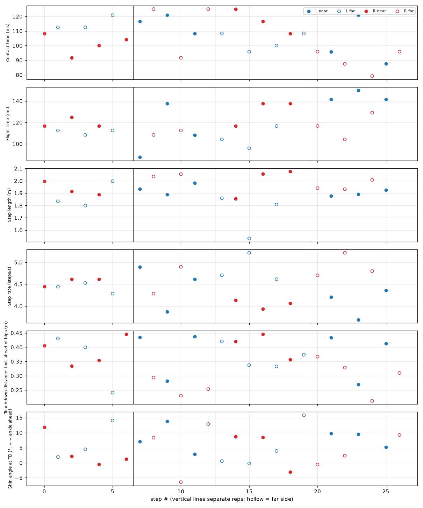

# A: measured data (2026-11-15)

Auto-generated from the pipeline. Numbers only, no interpretation: see `report_A.md` for that.
Mean ± SD across steps (n = steps). Event timing ±1 frame per event; contact/flight worst case ±2 frames.

## Data quality

| rep | fps | tracked | detect | leg swaps fixed | near side (exp/det) | scale | speed (m/s) | cutoffs used (Hz) |
|---|---|---|---|---|---|---|---|---|
| sprint_1_right | 240 | 429 | 93% | 0% of frames | R/R | 7.22 mm/px | 8.49 ± 0.07 | 10.0–16.5 |
| sprint_2_left | 240 | 420 | 90% | 8% of frames | L/L | 7.22 mm/px | 8.83 ± 0.07 | 12.5–17.0 |
| sprint_3_right_control | 240 | 445 | 93% | 1% of frames | R/R | 7.22 mm/px | 8.21 ± 0.06 | 12.0–16.5 |
| sprint_4_left_control | 240 | 419 | 96% | 3% of frames | L/L | 7.22 mm/px | 8.54 ± 0.07 | 12.0–16.0 |

Segment-length check (tracked vs reference, median error; share of frames off by >5%):

- sprint_1_right: thigh_L -10% (89%), shank_L -5% (52%), thigh_R -6% (58%), shank_R -3% (38%)
- sprint_2_left: thigh_L -2% (40%), shank_L +1% (32%), thigh_R -5% (59%), shank_R -1% (48%)
- sprint_3_right_control: thigh_L -8% (76%), shank_L -4% (52%), thigh_R -7% (63%), shank_R -5% (49%)
- sprint_4_left_control: thigh_L -7% (67%), shank_L -2% (24%), thigh_R -10% (87%), shank_R -1% (43%)

Anthropometrics: measured.

## By rep type, near-side leg only (high confidence)

| metric | fly | fly_control |
|---|---|---|
| Contact time (ms) | 107 ± 10 (n=7) | 109 ± 15 (n=6) |
| Flight time (ms) | 115 ± 17 (n=6) | 137 ± 11 (n=6) |
| Step time (ms) | 223 ± 19 (n=6) | 247 ± 15 (n=6) |
| Step rate (steps/s) | 4.51 ± 0.35 (n=6) | 4.07 ± 0.23 (n=6) |
| Step length (m) | 1.93 ± 0.05 (n=6) | 1.95 ± 0.10 (n=6) |
| Step length ÷ leg length | 1.98 ± 0.05 (n=6) | 1.99 ± 0.10 (n=6) |
| Duty factor | 0.484 ± 0.050 (n=6) | 0.441 ± 0.047 (n=6) |
| Touchdown distance: foot ahead of hips (m) | 0.38 ± 0.06 (n=7) | 0.39 ± 0.07 (n=6) |
| Touchdown distance: foot ahead of CM (m) | 0.34 ± 0.06 (n=7) | 0.35 ± 0.07 (n=6) |
| Foot horiz. speed at TD (m/s, − = backward) | 3 ± 1 (n=7) | 3 ± 1 (n=6) |
| Foot speed rel. hips at TD (m/s) | -6 ± 1 (n=7) | -5 ± 1 (n=6) |
| Shin angle at TD (°, + = ankle ahead) | 5.5 ± 5.5 (n=7) | 6.4 ± 4.9 (n=6) |
| Shin angle at TO (°) | -44.4 ± 3.1 (n=5) | -45.3 ± 3.4 (n=4) |
| Thigh angle at TD (°) | 31.6 ± 2.6 (n=7) | 33.8 ± 4.2 (n=6) |
| Thigh angle at TO (°) | -33.4 ± 4.4 (n=5) | -31.2 ± 4.9 (n=4) |
| Knee flexion at TD (°) | 26.1 ± 5.5 (n=7) | 27.4 ± 5.0 (n=6) |
| Knee flexion at TO (°) | 11.0 ± 4.2 (n=5) | 14.1 ± 3.1 (n=4) |
| Max knee flexion in stance (°) | 30.0 ± 4.7 (n=6) | 34.6 ± 5.8 (n=4) |
| Trunk lean at TD (°) | 8.5 ± 4.1 (n=7) | 9.4 ± 3.6 (n=6) |
| Max thigh angle in swing (knee lift, °) | 66.9 ± 4.1 (n=5) | 65.4 ± 2.2 (n=4) |
| Thigh range of motion (°) | 99.9 ± 5.8 (n=5) | 90.4 ± 20.1 (n=4) |
| CM vertical oscillation per step (m) | 0.05 ± 0.01 (n=6) | 0.05 ± 0.02 (n=6) |
| CM oscillation ÷ height | 0.027 ± 0.006 (n=6) | 0.030 ± 0.012 (n=6) |
| Braking: CM speed dip after TD (m/s) | 1 ± 0 (n=7) | 1 ± 0 (n=6) |
| Braking (% of speed) | 6.0 ± 3.2 (n=7) | 7.5 ± 3.7 (n=6) |
| Peak vertical force (× body weight, spring-mass est.) | 3.27 ± 0.32 (n=6) | 3.59 ± 0.38 (n=6) |
| Vertical stiffness (N/m/kg) | 1405 ± 233 (n=6) | 1323 ± 321 (n=6) |
| Leg stiffness (N/m/kg) | 236 ± 74 (n=6) | 266 ± 95 (n=6) |
| Peak vertical force (N, est.) | 1980.00 ± 193.26 (n=6) | 2174.06 ± 227.42 (n=6) |
| Vertical stiffness (kN/m) | 86.67 ± 14.35 (n=6) | 81.64 ± 19.81 (n=6) |
| Leg stiffness (kN/m) | 14.57 ± 4.57 (n=6) | 16.39 ± 5.87 (n=6) |
| Max knee flexion in swing (heel recovery, °) | 150.3 ± 0.6 (n=5) | 150.0 ± 1.2 (n=4) |
| Foot angle at TD (°, + = toes up / rearfoot) | -1.3 ± 3.5 (n=7) | -1.0 ± 3.4 (n=6) |
| Arm swing forward: shoulder flexion (°) | 8.4 ± 4.8 (n=5) | 10.6 ± 3.1 (n=2) |
| Arm swing back: shoulder extension (°) | 67.6 ± 5.0 (n=5) | 63.6 ± 3.3 (n=2) |
| Shoulder range of motion (°) | 76.0 ± 7.7 (n=5) | 74.2 ± 0.2 (n=2) |
| Elbow angle, arm at front (°) | 62.0 ± 7.0 (n=5) | 61.7 ± 3.9 (n=2) |
| Elbow angle, arm at back (°) | 128.0 ± 12.7 (n=5) | 119.3 ± 22.0 (n=2) |
| Elbow angle, min (°) | 53.7 ± 4.5 (n=5) | 58.3 ± 5.1 (n=2) |
| Elbow angle, max (°) | 151.8 ± 7.7 (n=5) | 149.6 ± 13.3 (n=2) |
| Elbow range of motion (°) | 98.0 ± 6.4 (n=5) | 91.3 ± 8.2 (n=2) |
| Hand height at front of swing, rel. shoulder (m) | -0.13 ± 0.04 (n=5) | -0.14 ± 0.01 (n=2) |
| Hand behind hip at back of swing (m) | 0.33 ± 0.11 (n=5) | 0.21 ± 0.07 (n=2) |
| Arm–leg timing: arm furthest back → same-side knee furthest forward (ms) | -11 ± 5 (n=5) | -129 ± 206 (n=2) |

## By rep

| metric | sprint_1_right · near | sprint_1_right · far | sprint_2_left · near | sprint_2_left · far | sprint_3_right_control · far | sprint_3_right_control · near | sprint_4_left_control · far | sprint_4_left_control · near |
|---|---|---|---|---|---|---|---|---|
| Contact time (ms) | 101 ± 7 (n=4) | 115 ± 5 (n=3) | 115 ± 6 (n=3) | 114 ± 19 (n=3) | 103 ± 6 (n=4) | 117 ± 8 (n=3) | 90 ± 8 (n=4) | 101 ± 17 (n=3) |
| Flight time (ms) | 119 ± 5 (n=3) | 111 ± 2 (n=3) | 111 ± 25 (n=3) | 110 ± 3 (n=2) | 106 ± 10 (n=3) | 131 ± 12 (n=3) | 117 ± 13 (n=3) | 144 ± 5 (n=3) |
| Step time (ms) | 219 ± 5 (n=3) | 226 ± 6 (n=3) | 226 ± 28 (n=3) | 219 ± 21 (n=2) | 207 ± 13 (n=3) | 247 ± 6 (n=3) | 204 ± 11 (n=3) | 246 ± 22 (n=3) |
| Step rate (steps/s) | 4.56 ± 0.10 (n=3) | 4.42 ± 0.12 (n=3) | 4.46 ± 0.53 (n=3) | 4.59 ± 0.43 (n=2) | 4.85 ± 0.32 (n=3) | 4.05 ± 0.10 (n=3) | 4.91 ± 0.27 (n=3) | 4.09 ± 0.35 (n=3) |
| Step length (m) | 1.93 ± 0.06 (n=3) | 1.88 ± 0.11 (n=3) | 1.94 ± 0.05 (n=3) | 2.04 ± 0.01 (n=2) | 1.73 ± 0.18 (n=3) | 2.00 ± 0.12 (n=3) | 1.96 ± 0.04 (n=3) | 1.90 ± 0.02 (n=3) |
| Step length ÷ leg length | 1.98 ± 0.06 (n=3) | 1.92 ± 0.11 (n=3) | 1.98 ± 0.05 (n=3) | 2.09 ± 0.01 (n=2) | 1.77 ± 0.18 (n=3) | 2.04 ± 0.12 (n=3) | 2.00 ± 0.04 (n=3) | 1.94 ± 0.02 (n=3) |
| Duty factor | 0.455 ± 0.030 (n=3) | 0.509 ± 0.009 (n=3) | 0.513 ± 0.053 (n=3) | 0.492 ± 0.061 (n=2) | 0.490 ± 0.026 (n=3) | 0.472 ± 0.040 (n=3) | 0.429 ± 0.043 (n=3) | 0.410 ± 0.033 (n=3) |
| Touchdown distance: foot ahead of hips (m) | 0.38 ± 0.05 (n=4) | 0.36 ± 0.10 (n=3) | 0.38 ± 0.09 (n=3) | 0.26 ± 0.03 (n=3) | 0.37 ± 0.04 (n=4) | 0.41 ± 0.05 (n=3) | 0.30 ± 0.07 (n=4) | 0.37 ± 0.09 (n=3) |
| Touchdown distance: foot ahead of CM (m) | 0.35 ± 0.04 (n=4) | 0.31 ± 0.11 (n=3) | 0.33 ± 0.08 (n=3) | 0.20 ± 0.04 (n=3) | 0.31 ± 0.04 (n=4) | 0.37 ± 0.06 (n=3) | 0.25 ± 0.07 (n=4) | 0.32 ± 0.08 (n=3) |
| Foot horiz. speed at TD (m/s, − = backward) | 2 ± 0 (n=4) | 3 ± 0 (n=3) | 3 ± 0 (n=3) | 5 ± 4 (n=3) | 2 ± 0 (n=4) | 3 ± 1 (n=3) | 2 ± 1 (n=4) | 4 ± 2 (n=3) |
| Foot speed rel. hips at TD (m/s) | -6 ± 0 (n=4) | -5 ± 0 (n=3) | -5 ± 1 (n=3) | -4 ± 4 (n=3) | -6 ± 1 (n=4) | -5 ± 2 (n=3) | -7 ± 1 (n=4) | -5 ± 2 (n=3) |
| Shin angle at TD (°, + = ankle ahead) | 3.7 ± 5.5 (n=4) | 6.8 ± 6.4 (n=3) | 7.9 ± 5.5 (n=3) | 4.9 ± 10.1 (n=3) | 5.0 ± 7.4 (n=4) | 4.7 ± 6.8 (n=3) | 3.6 ± 5.1 (n=3) | 8.1 ± 2.5 (n=3) |
| Shin angle at TO (°) | -43.5 ± 2.6 (n=4) | -48.6 ± 2.3 (n=3) | -48.2 (n=1) | -51.6 ± 2.1 (n=3) | -41.5 ± 5.5 (n=4) | -47.8 ± 0.5 (n=2) | -43.4 ± 0.9 (n=3) | -42.9 ± 3.0 (n=2) |
| Thigh angle at TD (°) | 31.3 ± 2.9 (n=4) | 30.3 ± 2.7 (n=3) | 32.0 ± 2.5 (n=3) | 30.8 ± 11.2 (n=3) | 24.3 ± 5.3 (n=4) | 35.1 ± 3.0 (n=3) | 21.9 ± 3.3 (n=3) | 32.5 ± 5.5 (n=3) |
| Thigh angle at TO (°) | -31.9 ± 3.0 (n=4) | -33.3 ± 1.8 (n=3) | -39.7 (n=1) | -31.8 ± 2.5 (n=3) | -31.9 ± 2.3 (n=4) | -35.4 ± 0.7 (n=2) | -29.7 ± 2.1 (n=3) | -27.0 ± 1.0 (n=2) |
| Knee flexion at TD (°) | 27.6 ± 6.7 (n=4) | 23.5 ± 8.9 (n=3) | 24.1 ± 3.6 (n=3) | 25.8 ± 6.5 (n=3) | 19.3 ± 11.8 (n=4) | 30.4 ± 3.9 (n=3) | 18.2 ± 6.7 (n=3) | 24.3 ± 4.4 (n=3) |
| Knee flexion at TO (°) | 11.6 ± 4.6 (n=4) | 15.3 ± 1.1 (n=3) | 8.5 (n=1) | 19.8 ± 0.6 (n=3) | 9.9 ± 6.3 (n=4) | 12.4 ± 1.1 (n=2) | 13.8 ± 1.4 (n=3) | 15.8 ± 3.9 (n=2) |
| Max knee flexion in stance (°) | 32.0 ± 4.6 (n=4) | 29.3 ± 4.9 (n=3) | 26.0 ± 0.8 (n=2) | 27.0 ± 3.3 (n=3) | 25.6 ± 8.9 (n=4) | 36.3 ± 7.2 (n=2) | 28.8 ± 3.4 (n=3) | 32.9 ± 6.1 (n=2) |
| Trunk lean at TD (°) | 7.0 ± 4.5 (n=4) | 8.7 ± 2.7 (n=3) | 10.5 ± 3.1 (n=3) | 10.6 ± 2.0 (n=3) | 11.2 ± 2.2 (n=4) | 9.1 ± 3.8 (n=3) | 11.2 ± 1.3 (n=4) | 9.8 ± 4.3 (n=3) |
| Max thigh angle in swing (knee lift, °) | 68.1 ± 5.4 (n=3) | 65.5 ± 1.6 (n=2) | 65.3 ± 0.2 (n=2) | 52.3 ± 15.9 (n=2) | 62.6 ± 2.6 (n=3) | 65.5 ± 3.5 (n=2) | 59.0 ± 15.6 (n=3) | 65.3 ± 1.5 (n=2) |
| Thigh range of motion (°) | 101.0 ± 3.6 (n=3) | 99.3 ± 4.4 (n=2) | 98.3 ± 10.0 (n=2) | 84.3 ± 17.6 (n=2) | 95.4 ± 4.1 (n=3) | 101.8 ± 2.8 (n=2) | 92.5 ± 15.7 (n=3) | 78.9 ± 26.1 (n=2) |
| CM vertical oscillation per step (m) | 0.05 ± 0.01 (n=3) | 0.06 ± 0.01 (n=3) | 0.05 ± 0.01 (n=3) | 0.04 ± 0.01 (n=2) | 0.04 ± 0.01 (n=3) | 0.06 ± 0.02 (n=3) | 0.04 ± 0.01 (n=3) | 0.04 ± 0.01 (n=3) |
| CM oscillation ÷ height | 0.028 ± 0.007 (n=3) | 0.032 ± 0.003 (n=3) | 0.026 ± 0.006 (n=3) | 0.024 ± 0.007 (n=2) | 0.023 ± 0.004 (n=3) | 0.037 ± 0.014 (n=3) | 0.025 ± 0.006 (n=3) | 0.024 ± 0.007 (n=3) |
| Braking: CM speed dip after TD (m/s) | 0 ± 0 (n=4) | 0 ± 0 (n=3) | 1 ± 0 (n=3) | 1 ± 0 (n=3) | 1 ± 1 (n=4) | 1 ± 0 (n=3) | 0 ± 0 (n=4) | 1 ± 0 (n=3) |
| Braking (% of speed) | 5.4 ± 4.2 (n=4) | 3.9 ± 0.9 (n=3) | 6.9 ± 1.5 (n=3) | 7.3 ± 1.7 (n=3) | 9.9 ± 7.7 (n=4) | 8.2 ± 3.7 (n=3) | 3.4 ± 3.9 (n=4) | 6.8 ± 4.3 (n=3) |
| Peak vertical force (× body weight, spring-mass est.) | 3.46 ± 0.23 (n=3) | 3.09 ± 0.05 (n=3) | 3.08 ± 0.31 (n=3) | 3.22 ± 0.40 (n=2) | 3.21 ± 0.17 (n=3) | 3.34 ± 0.27 (n=3) | 3.69 ± 0.39 (n=3) | 3.84 ± 0.30 (n=3) |
| Vertical stiffness (N/m/kg) | 1553 ± 203 (n=3) | 1241 ± 88 (n=3) | 1256 ± 166 (n=3) | 1452 ± 512 (n=2) | 1573 ± 185 (n=3) | 1161 ± 114 (n=3) | 1973 ± 292 (n=3) | 1485 ± 408 (n=3) |
| Leg stiffness (N/m/kg) | 291 ± 64 (n=3) | 195 ± 19 (n=3) | 182 ± 25 (n=3) | 234 ± 124 (n=2) | 280 ± 40 (n=3) | 216 ± 44 (n=3) | 399 ± 107 (n=3) | 315 ± 115 (n=3) |
| Peak vertical force (N, est.) | 2093.98 ± 139.44 (n=3) | 1867.94 ± 32.82 (n=3) | 1866.02 ± 186.96 (n=3) | 1946.19 ± 242.43 (n=2) | 1942.16 ± 103.67 (n=3) | 2022.32 ± 165.22 (n=3) | 2230.96 ± 235.09 (n=3) | 2325.79 ± 181.46 (n=3) |
| Vertical stiffness (kN/m) | 95.83 ± 12.55 (n=3) | 76.58 ± 5.46 (n=3) | 77.51 ± 10.26 (n=3) | 89.61 ± 31.58 (n=2) | 97.08 ± 11.40 (n=3) | 71.65 ± 7.01 (n=3) | 121.72 ± 18.02 (n=3) | 91.63 ± 25.15 (n=3) |
| Leg stiffness (kN/m) | 17.94 ± 3.98 (n=3) | 12.05 ± 1.16 (n=3) | 11.20 ± 1.53 (n=3) | 14.43 ± 7.67 (n=2) | 17.29 ± 2.44 (n=3) | 13.34 ± 2.74 (n=3) | 24.62 ± 6.58 (n=3) | 19.44 ± 7.12 (n=3) |
| Max knee flexion in swing (heel recovery, °) | 150.1 ± 0.3 (n=3) | 146.8 (n=1) | 150.7 ± 0.8 (n=2) | — | 147.2 ± 2.4 (n=3) | 150.9 ± 1.0 (n=2) | — | 149.1 ± 0.2 (n=2) |
| Foot angle at TD (°, + = toes up / rearfoot) | -3.0 ± 1.5 (n=4) | -1.4 ± 2.8 (n=3) | 1.0 ± 4.5 (n=3) | 3.9 ± 6.1 (n=3) | -4.9 ± 2.2 (n=4) | -1.7 ± 1.7 (n=3) | -2.1 ± 1.0 (n=4) | -0.3 ± 4.9 (n=3) |
| Arm swing forward: shoulder flexion (°) | 7.0 ± 6.1 (n=3) | — | 10.6 ± 0.1 (n=2) | — | — | 12.7 (n=1) | — | 8.4 (n=1) |
| Arm swing back: shoulder extension (°) | 66.7 ± 3.9 (n=3) | — | 69.0 ± 8.1 (n=2) | — | — | 61.3 (n=1) | — | 66.0 (n=1) |
| Shoulder range of motion (°) | 73.6 ± 8.1 (n=3) | — | 79.6 ± 8.0 (n=2) | — | — | 74.0 (n=1) | — | 74.3 (n=1) |
| Elbow angle, arm at front (°) | 58.4 ± 6.7 (n=3) | — | 67.6 ± 2.1 (n=2) | — | — | 58.9 (n=1) | — | 64.4 (n=1) |
| Elbow angle, arm at back (°) | 136.5 ± 6.9 (n=3) | — | 115.2 ± 1.5 (n=2) | — | — | 134.9 (n=1) | — | 103.8 (n=1) |
| Elbow angle, min (°) | 50.9 ± 3.2 (n=3) | — | 58.0 ± 0.7 (n=2) | — | — | 54.6 (n=1) | — | 61.9 (n=1) |
| Elbow angle, max (°) | 147.1 ± 5.8 (n=3) | — | 158.8 ± 2.7 (n=2) | — | — | 140.1 (n=1) | — | 159.0 (n=1) |
| Elbow range of motion (°) | 96.2 ± 8.3 (n=3) | — | 100.8 ± 1.9 (n=2) | — | — | 85.5 (n=1) | — | 97.1 (n=1) |
| Hand height at front of swing, rel. shoulder (m) | -0.11 ± 0.04 (n=3) | — | -0.15 ± 0.01 (n=2) | — | — | -0.13 (n=1) | — | -0.14 (n=1) |
| Hand behind hip at back of swing (m) | 0.37 ± 0.11 (n=3) | — | 0.28 ± 0.11 (n=2) | — | — | 0.26 (n=1) | — | 0.16 (n=1) |
| Arm–leg timing: arm furthest back → same-side knee furthest forward (ms) | -11 ± 6 (n=3) | — | -10 ± 3 (n=2) | — | — | 17 (n=1) | — | -275 (n=1) |

## Right vs left (near-side values only)

| metric | R (→ reps) | L (← reps) | R − L | % diff |
|---|---|---|---|---|
| Contact time (ms) | 108 ± 11 (n=7) | 108 ± 14 (n=6) | -0.595 | -0.6% |
| Flight time (ms) | 125 ± 10 (n=6) | 128 ± 24 (n=6) | -2.78 | -2.2% |
| Step time (ms) | 233 ± 16 (n=6) | 236 ± 25 (n=6) | -2.78 | -1.2% |
| Step rate (steps/s) | 4.30 ± 0.29 (n=6) | 4.28 ± 0.45 (n=6) | +0.0274 | +0.6% |
| Step length (m) | 1.96 ± 0.09 (n=6) | 1.92 ± 0.04 (n=6) | +0.0477 | +2.5% |
| Step length ÷ leg length | 2.01 ± 0.09 (n=6) | 1.96 ± 0.04 (n=6) | +0.0488 | +2.5% |
| Duty factor | 0.464 ± 0.033 (n=6) | 0.462 ± 0.069 (n=6) | +0.00206 | +0.4% |
| Touchdown distance: foot ahead of hips (m) | 0.39 ± 0.05 (n=7) | 0.38 ± 0.08 (n=6) | +0.0163 | +4.2% |
| Touchdown distance: foot ahead of CM (m) | 0.36 ± 0.05 (n=7) | 0.33 ± 0.07 (n=6) | +0.028 | +8.2% |
| Foot horiz. speed at TD (m/s, − = backward) | 2 ± 1 (n=7) | 3 ± 1 (n=6) | -1.05 | -37.0% |
| Foot speed rel. hips at TD (m/s) | -6 ± 1 (n=7) | -5 ± 1 (n=6) | -0.811 | -15.3% |
| Shin angle at TD (°, + = ankle ahead) | 4.1 ± 5.6 (n=7) | 8.0 ± 3.8 (n=6) | -3.9 | -64.3% |
| Shin angle at TO (°) | -44.9 ± 3.0 (n=6) | -44.6 ± 3.8 (n=3) | -0.266 | -0.6% |
| Thigh angle at TD (°) | 32.9 ± 3.4 (n=7) | 32.2 ± 3.9 (n=6) | +0.667 | +2.0% |
| Thigh angle at TO (°) | -33.0 ± 3.0 (n=6) | -31.3 ± 7.3 (n=3) | -1.78 | -5.5% |
| Knee flexion at TD (°) | 28.8 ± 5.4 (n=7) | 24.2 ± 3.6 (n=6) | +4.56 | +17.2% |
| Knee flexion at TO (°) | 11.9 ± 3.6 (n=6) | 13.4 ± 5.1 (n=3) | -1.51 | -12.0% |
| Max knee flexion in stance (°) | 33.4 ± 5.3 (n=6) | 29.4 ± 5.3 (n=4) | +3.96 | +12.6% |
| Trunk lean at TD (°) | 7.9 ± 4.0 (n=7) | 10.1 ± 3.4 (n=6) | -2.22 | -24.6% |
| Max thigh angle in swing (knee lift, °) | 67.1 ± 4.4 (n=5) | 65.3 ± 0.8 (n=4) | +1.78 | +2.7% |
| Thigh range of motion (°) | 101.3 ± 3.0 (n=5) | 88.6 ± 19.6 (n=4) | +12.7 | +13.4% |
| CM vertical oscillation per step (m) | 0.06 ± 0.02 (n=6) | 0.04 ± 0.01 (n=6) | +0.0135 | +27.0% |
| CM oscillation ÷ height | 0.032 ± 0.011 (n=6) | 0.025 ± 0.006 (n=6) | +0.00772 | +27.0% |
| Braking: CM speed dip after TD (m/s) | 1 ± 0 (n=7) | 1 ± 0 (n=6) | -0.0369 | -6.4% |
| Braking (% of speed) | 6.6 ± 3.9 (n=7) | 6.8 ± 2.9 (n=6) | -0.24 | -3.6% |
| Peak vertical force (× body weight, spring-mass est.) | 3.40 ± 0.24 (n=6) | 3.46 ± 0.50 (n=6) | -0.0624 | -1.8% |
| Vertical stiffness (N/m/kg) | 1357 ± 260 (n=6) | 1371 ± 305 (n=6) | -13.4 | -1.0% |
| Leg stiffness (N/m/kg) | 253 ± 64 (n=6) | 248 ± 104 (n=6) | +5.13 | +2.0% |
| Peak vertical force (N, est.) | 2058.15 ± 142.26 (n=6) | 2095.91 ± 300.95 (n=6) | -37.8 | -1.8% |
| Vertical stiffness (kN/m) | 83.74 ± 16.07 (n=6) | 84.57 ± 18.84 (n=6) | -0.827 | -1.0% |
| Leg stiffness (kN/m) | 15.64 ± 3.96 (n=6) | 15.32 ± 6.45 (n=6) | +0.317 | +2.0% |
| Max knee flexion in swing (heel recovery, °) | 150.4 ± 0.7 (n=5) | 149.9 ± 1.0 (n=4) | +0.543 | +0.4% |
| Foot angle at TD (°, + = toes up / rearfoot) | -2.4 ± 1.6 (n=7) | 0.4 ± 4.3 (n=6) | -2.81 | -200.0% |
| Arm swing forward: shoulder flexion (°) | 8.4 ± 5.8 (n=4) | 9.9 ± 1.3 (n=3) | -1.46 | -16.0% |
| Arm swing back: shoulder extension (°) | 65.3 ± 4.1 (n=4) | 68.0 ± 6.0 (n=3) | -2.64 | -4.0% |
| Shoulder range of motion (°) | 73.7 ± 6.7 (n=4) | 77.8 ± 6.4 (n=3) | -4.11 | -5.4% |
| Elbow angle, arm at front (°) | 58.5 ± 5.5 (n=4) | 66.5 ± 2.3 (n=3) | -8.02 | -12.8% |
| Elbow angle, arm at back (°) | 136.1 ± 5.7 (n=4) | 111.4 ± 6.7 (n=3) | +24.7 | +20.0% |
| Elbow angle, min (°) | 51.9 ± 3.2 (n=4) | 59.3 ± 2.3 (n=3) | -7.4 | -13.3% |
| Elbow angle, max (°) | 145.4 ± 5.9 (n=4) | 158.8 ± 1.9 (n=3) | -13.5 | -8.8% |
| Elbow range of motion (°) | 93.5 ± 8.6 (n=4) | 99.6 ± 2.5 (n=3) | -6.05 | -6.3% |
| Hand height at front of swing, rel. shoulder (m) | -0.11 ± 0.03 (n=4) | -0.15 ± 0.01 (n=3) | +0.0316 | +24.2% |
| Hand behind hip at back of swing (m) | 0.34 ± 0.10 (n=4) | 0.24 ± 0.10 (n=3) | +0.102 | +35.3% |
| Arm–leg timing: arm furthest back → same-side knee furthest forward (ms) | -4 ± 15 (n=4) | -99 ± 153 (n=3) | +94.4 | +183.8% |

## Speed vs long-jump goal

Distance from the athlete's equation: ft = 1.57 × approach mph − 8.87 + 0.18 × (height in − 70). It assumes optimal form, so treat it as a ceiling. It applies to *approach* speed: a flying sprint is faster than a real approach (approaches are typically 92–97% of top speed).

**Goal 21'9" (6.63 m) needs ≈ 19.6 mph (8.77 m/s) of approach speed.**

| rep | type | zone speed (m/s) | mph | % of best flying sprint | equation distance |
|---|---|---|---|---|---|
| sprint_1_right | fly | 8.49 ± 0.07 | 19.0 ± 0.1 | 96.1% | 20'9" ± 3 in |
| sprint_2_left | fly | 8.83 ± 0.07 | 19.8 ± 0.2 | 100.0% | 22'0" ± 3 in |
| sprint_3_right_control | fly_control | 8.21 ± 0.06 | 18.4 ± 0.1 | 93.0% | 19'10" ± 3 in |
| sprint_4_left_control | fly_control | 8.54 ± 0.07 | 19.1 ± 0.1 | 96.8% | 21'0" ± 3 in |
