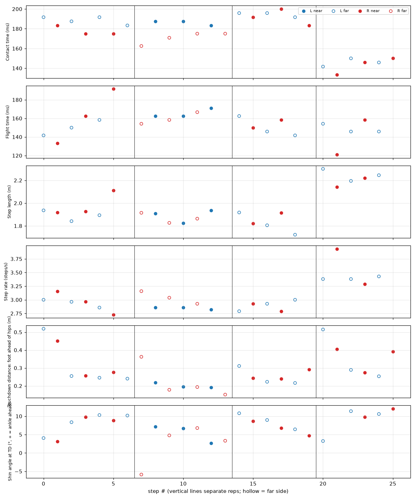

# B: measured data (2026-11-15)

Auto-generated from the pipeline. Numbers only, no interpretation: see `report_B.md` for that.
Mean ± SD across steps (n = steps). Event timing ±1 frame per event; contact/flight worst case ±2 frames.

## Data quality

| rep | fps | tracked | detect | leg swaps fixed | near side (exp/det) | scale | speed (m/s) | cutoffs used (Hz) |
|---|---|---|---|---|---|---|---|---|
| normal_1_right.mov | 240 | 633 | 94% | 4% of frames | R/R | 7.22 mm/px | 5.67 ± 0.03 | 8.0–14.0 |
| normal_2_left.mov | 240 | 649 | 94% | 3% of frames | L/L | 7.22 mm/px | 5.46 ± 0.03 | 11.0–14.0 |
| normal_3_right.mov | 240 | 653 | 96% | 1% of frames | R/R | 7.22 mm/px | 5.40 ± 0.03 | 10.5–14.0 |
| kick_4_right | 240 | 481 | 92% | 2% of frames | R/R | 7.22 mm/px | 7.58 ± 0.05 | 9.5–14.0 |

Segment-length check (tracked vs reference, median error; share of frames off by >5%):

- normal_1_right.mov: thigh_L -3% (35%), shank_L -2% (36%), thigh_R -0% (35%), shank_R +0% (39%)
- normal_2_left.mov: thigh_L -1% (32%), shank_L +1% (32%), thigh_R -4% (47%), shank_R -4% (45%)
- normal_3_right.mov: thigh_L -3% (39%), shank_L -2% (38%), thigh_R +1% (39%), shank_R +1% (31%)
- kick_4_right: thigh_L -1% (29%), shank_L +1% (42%), thigh_R +3% (41%), shank_R +5% (63%)

Anthropometrics: video-estimated (standing clip, A-referenced) + Winter ratios.

## By rep type, near-side leg only (high confidence)

| metric | mile_pace | kick_pace |
|---|---|---|
| Contact time (ms) | 185 ± 8 (n=9) | 143 ± 9 (n=3) |
| Flight time (ms) | 161 ± 17 (n=8) | 140 ± 27 (n=2) |
| Step time (ms) | 347 ± 15 (n=8) | 279 ± 35 (n=2) |
| Step rate (steps/s) | 2.89 ± 0.13 (n=8) | 3.61 ± 0.46 (n=2) |
| Step length (m) | 1.92 ± 0.09 (n=8) | 2.18 ± 0.06 (n=2) |
| Step length ÷ leg length | 1.96 ± 0.09 (n=8) | 2.23 ± 0.06 (n=2) |
| Duty factor | 0.535 ± 0.032 (n=8) | 0.502 ± 0.032 (n=2) |
| Touchdown distance: foot ahead of hips (m) | 0.26 ± 0.08 (n=9) | 0.36 ± 0.07 (n=3) |
| Touchdown distance: foot ahead of CM (m) | 0.21 ± 0.08 (n=9) | 0.31 ± 0.07 (n=3) |
| Foot horiz. speed at TD (m/s, − = backward) | 2 ± 0 (n=9) | 2 ± 1 (n=3) |
| Foot speed rel. hips at TD (m/s) | -3 ± 0 (n=9) | -5 ± 2 (n=3) |
| Shin angle at TD (°, + = ankle ahead) | 6.5 ± 2.5 (n=9) | 10.9 ± 1.6 (n=2) |
| Shin angle at TO (°) | -44.0 ± 2.4 (n=5) | — |
| Thigh angle at TD (°) | 33.9 ± 3.7 (n=9) | 37.4 ± 4.0 (n=2) |
| Thigh angle at TO (°) | -36.2 ± 2.1 (n=5) | — |
| Knee flexion at TD (°) | 27.5 ± 4.3 (n=9) | 26.5 ± 2.4 (n=2) |
| Knee flexion at TO (°) | 7.8 ± 1.9 (n=5) | — |
| Max knee flexion in stance (°) | 49.4 ± 2.5 (n=6) | 54.7 (n=1) |
| Trunk lean at TD (°) | 12.9 ± 3.8 (n=9) | 9.0 ± 3.3 (n=3) |
| Max thigh angle in swing (knee lift, °) | 49.9 ± 4.5 (n=6) | 54.6 ± 3.0 (n=2) |
| Thigh range of motion (°) | 91.2 ± 3.6 (n=6) | 97.5 ± 0.8 (n=2) |
| CM vertical oscillation per step (m) | 0.10 ± 0.02 (n=8) | 0.07 ± 0.02 (n=2) |
| CM oscillation ÷ height | 0.058 ± 0.010 (n=8) | 0.040 ± 0.009 (n=2) |
| Braking: CM speed dip after TD (m/s) | 1 ± 0 (n=9) | 1 ± 1 (n=3) |
| Braking (% of speed) | 12.9 ± 6.9 (n=9) | 11.0 ± 12.0 (n=3) |
| Peak vertical force (× body weight, spring-mass est.) | 2.94 ± 0.18 (n=8) | 3.14 ± 0.20 (n=2) |
| Vertical stiffness (N/m/kg) | 498 ± 34 (n=8) | 844 ± 141 (n=2) |
| Leg stiffness (N/m/kg) | 143 ± 13 (n=8) | 161 ± 15 (n=2) |
| Peak vertical force (N, est.) | 1989.46 ± 121.74 (n=8) | 2119.16 ± 134.73 (n=2) |
| Vertical stiffness (kN/m) | 34.29 ± 2.35 (n=8) | 58.17 ± 9.73 (n=2) |
| Leg stiffness (kN/m) | 9.85 ± 0.92 (n=8) | 11.08 ± 1.03 (n=2) |
| Max knee flexion in swing (heel recovery, °) | 141.3 ± 1.7 (n=6) | 144.4 ± 1.3 (n=2) |
| Foot angle at TD (°, + = toes up / rearfoot) | 4.1 ± 3.2 (n=9) | 6.2 ± 8.5 (n=3) |
| Arm swing forward: shoulder flexion (°) | 11.6 ± 25.5 (n=5) | 19.8 (n=1) |
| Arm swing back: shoulder extension (°) | 57.6 ± 6.9 (n=5) | 65.9 (n=1) |
| Shoulder range of motion (°) | 69.2 ± 27.0 (n=5) | 85.6 (n=1) |
| Elbow angle, arm at front (°) | 81.8 ± 43.0 (n=5) | 64.3 (n=1) |
| Elbow angle, arm at back (°) | 78.3 ± 16.4 (n=5) | 41.5 (n=1) |
| Elbow angle, min (°) | 55.9 ± 10.6 (n=5) | 38.5 (n=1) |
| Elbow angle, max (°) | 132.5 ± 23.6 (n=5) | 101.1 (n=1) |
| Elbow range of motion (°) | 76.6 ± 27.6 (n=5) | 62.6 (n=1) |
| Hand height at front of swing, rel. shoulder (m) | -0.21 ± 0.07 (n=5) | -0.11 (n=1) |
| Hand behind hip at back of swing (m) | 0.05 ± 0.06 (n=5) | 0.07 (n=1) |
| Arm–leg timing: arm furthest back → same-side knee furthest forward (ms) | -7 ± 29 (n=5) | -29 (n=1) |

## By rep

| metric | normal_1_right.mov · far | normal_1_right.mov · near | normal_2_left.mov · far | normal_2_left.mov · near | normal_3_right.mov · far | normal_3_right.mov · near | kick_4_right · far | kick_4_right · near |
|---|---|---|---|---|---|---|---|---|
| Contact time (ms) | 189 ± 4 (n=4) | 178 ± 5 (n=3) | 171 ± 6 (n=4) | 186 ± 2 (n=3) | 194 ± 2 (n=3) | 192 ± 8 (n=3) | 146 ± 4 (n=3) | 143 ± 9 (n=3) |
| Flight time (ms) | 150 ± 8 (n=3) | 162 ± 29 (n=3) | 160 ± 6 (n=3) | 165 ± 5 (n=3) | 150 ± 11 (n=3) | 154 ± 6 (n=2) | 149 ± 5 (n=3) | 140 ± 27 (n=2) |
| Step time (ms) | 340 ± 9 (n=3) | 340 ± 25 (n=3) | 329 ± 12 (n=3) | 351 ± 2 (n=3) | 344 ± 13 (n=3) | 350 ± 12 (n=2) | 294 ± 2 (n=3) | 279 ± 35 (n=2) |
| Step rate (steps/s) | 2.94 ± 0.07 (n=3) | 2.95 ± 0.22 (n=3) | 3.04 ± 0.12 (n=3) | 2.85 ± 0.02 (n=3) | 2.91 ± 0.11 (n=3) | 2.86 ± 0.10 (n=2) | 3.40 ± 0.03 (n=3) | 3.61 ± 0.46 (n=2) |
| Step length (m) | 1.89 ± 0.05 (n=3) | 1.99 ± 0.11 (n=3) | 1.87 ± 0.04 (n=3) | 1.89 ± 0.06 (n=3) | 1.81 ± 0.10 (n=3) | 1.87 ± 0.07 (n=2) | 2.25 ± 0.05 (n=3) | 2.18 ± 0.06 (n=2) |
| Step length ÷ leg length | 1.93 ± 0.05 (n=3) | 2.03 ± 0.11 (n=3) | 1.91 ± 0.05 (n=3) | 1.93 ± 0.06 (n=3) | 1.85 ± 0.10 (n=3) | 1.91 ± 0.07 (n=2) | 2.30 ± 0.05 (n=3) | 2.23 ± 0.06 (n=2) |
| Duty factor | 0.559 ± 0.014 (n=3) | 0.525 ± 0.051 (n=3) | 0.515 ± 0.004 (n=3) | 0.530 ± 0.010 (n=3) | 0.565 ± 0.016 (n=3) | 0.560 ± 0.002 (n=2) | 0.495 ± 0.015 (n=3) | 0.502 ± 0.032 (n=2) |
| Touchdown distance: foot ahead of hips (m) | 0.31 ± 0.14 (n=4) | 0.33 ± 0.11 (n=3) | 0.22 ± 0.10 (n=4) | 0.20 ± 0.01 (n=3) | 0.25 ± 0.05 (n=3) | 0.26 ± 0.03 (n=3) | 0.35 ± 0.14 (n=3) | 0.36 ± 0.07 (n=3) |
| Touchdown distance: foot ahead of CM (m) | 0.26 ± 0.13 (n=4) | 0.28 ± 0.11 (n=3) | 0.16 ± 0.10 (n=4) | 0.16 ± 0.04 (n=3) | 0.20 ± 0.04 (n=3) | 0.20 ± 0.01 (n=3) | 0.31 ± 0.14 (n=3) | 0.31 ± 0.07 (n=3) |
| Foot horiz. speed at TD (m/s, − = backward) | 2 ± 1 (n=4) | 2 ± 1 (n=3) | 2 ± 1 (n=4) | 2 ± 0 (n=3) | 2 ± 0 (n=3) | 2 ± 0 (n=3) | 3 ± 1 (n=3) | 2 ± 1 (n=3) |
| Foot speed rel. hips at TD (m/s) | -4 ± 1 (n=4) | -4 ± 1 (n=3) | -4 ± 1 (n=4) | -3 ± 0 (n=3) | -3 ± 0 (n=3) | -3 ± 0 (n=3) | -5 ± 2 (n=3) | -5 ± 2 (n=3) |
| Shin angle at TD (°, + = ankle ahead) | 8.2 ± 2.9 (n=4) | 7.2 ± 3.6 (n=3) | 2.2 ± 5.6 (n=4) | 5.5 ± 2.5 (n=3) | 8.7 ± 2.2 (n=3) | 6.7 ± 2.0 (n=3) | 8.4 ± 4.5 (n=3) | 10.9 ± 1.6 (n=2) |
| Shin angle at TO (°) | -45.2 ± 8.0 (n=3) | -46.9 (n=1) | -40.8 ± 1.6 (n=4) | -44.4 ± 0.3 (n=3) | -45.3 ± 1.0 (n=3) | -40.2 (n=1) | -46.8 ± 3.8 (n=3) | — |
| Thigh angle at TD (°) | 33.1 ± 1.5 (n=4) | 35.5 ± 2.3 (n=3) | 27.8 ± 1.5 (n=4) | 30.0 ± 2.8 (n=3) | 31.5 ± 2.2 (n=3) | 36.3 ± 2.4 (n=3) | 34.4 ± 1.7 (n=3) | 37.4 ± 4.0 (n=2) |
| Thigh angle at TO (°) | -30.6 ± 10.5 (n=3) | -38.5 (n=1) | -31.9 ± 3.5 (n=4) | -36.2 ± 2.0 (n=3) | -31.9 ± 1.9 (n=3) | -34.0 (n=1) | -29.1 ± 5.7 (n=3) | — |
| Knee flexion at TD (°) | 24.9 ± 4.4 (n=4) | 28.3 ± 5.8 (n=3) | 25.5 ± 5.1 (n=4) | 24.5 ± 1.4 (n=3) | 22.8 ± 2.1 (n=3) | 29.6 ± 4.1 (n=3) | 26.0 ± 4.2 (n=3) | 26.5 ± 2.4 (n=2) |
| Knee flexion at TO (°) | 14.6 ± 3.9 (n=3) | 8.5 (n=1) | 8.9 ± 4.1 (n=4) | 8.1 ± 2.4 (n=3) | 13.4 ± 2.9 (n=3) | 6.2 (n=1) | 17.6 ± 4.2 (n=3) | — |
| Max knee flexion in stance (°) | 43.3 ± 5.5 (n=3) | 52.5 (n=1) | 39.4 ± 5.7 (n=4) | 47.5 ± 0.9 (n=3) | 42.4 ± 2.6 (n=3) | 50.7 ± 2.3 (n=2) | 37.9 ± 4.4 (n=3) | 54.7 (n=1) |
| Trunk lean at TD (°) | 11.6 ± 2.1 (n=4) | 12.3 ± 1.7 (n=3) | 15.3 ± 1.3 (n=4) | 12.7 ± 6.7 (n=3) | 13.0 ± 3.4 (n=3) | 13.8 ± 2.8 (n=3) | 8.0 ± 2.3 (n=3) | 9.0 ± 3.3 (n=3) |
| Max thigh angle in swing (knee lift, °) | 50.7 ± 5.1 (n=3) | 51.1 ± 5.6 (n=2) | 52.5 ± 1.7 (n=3) | 46.2 ± 3.8 (n=2) | 50.1 ± 3.0 (n=2) | 52.3 ± 3.6 (n=2) | 55.2 ± 5.2 (n=2) | 54.6 ± 3.0 (n=2) |
| Thigh range of motion (°) | 88.6 ± 7.2 (n=3) | 93.1 ± 4.8 (n=2) | 96.1 ± 3.5 (n=3) | 89.1 ± 4.4 (n=2) | 87.2 ± 2.5 (n=2) | 91.5 ± 2.7 (n=2) | 94.6 ± 7.8 (n=2) | 97.5 ± 0.8 (n=2) |
| CM vertical oscillation per step (m) | 0.10 ± 0.00 (n=3) | 0.10 ± 0.02 (n=3) | 0.10 ± 0.01 (n=3) | 0.09 ± 0.01 (n=3) | 0.09 ± 0.03 (n=3) | 0.12 ± 0.02 (n=2) | 0.08 ± 0.02 (n=3) | 0.07 ± 0.02 (n=2) |
| CM oscillation ÷ height | 0.055 ± 0.002 (n=3) | 0.056 ± 0.012 (n=3) | 0.054 ± 0.006 (n=3) | 0.053 ± 0.004 (n=3) | 0.051 ± 0.015 (n=3) | 0.069 ± 0.010 (n=2) | 0.048 ± 0.009 (n=3) | 0.040 ± 0.009 (n=2) |
| Braking: CM speed dip after TD (m/s) | 1 ± 0 (n=4) | 1 ± 0 (n=3) | 1 ± 0 (n=4) | 1 ± 1 (n=3) | 1 ± 0 (n=3) | 1 ± 0 (n=3) | 1 ± 0 (n=3) | 1 ± 1 (n=3) |
| Braking (% of speed) | 10.5 ± 0.8 (n=4) | 11.8 ± 0.3 (n=3) | 11.2 ± 4.0 (n=4) | 16.7 ± 11.6 (n=3) | 10.6 ± 1.9 (n=3) | 10.2 ± 4.5 (n=3) | 9.7 ± 1.9 (n=3) | 11.0 ± 12.0 (n=3) |
| Peak vertical force (× body weight, spring-mass est.) | 2.81 ± 0.07 (n=3) | 3.01 ± 0.29 (n=3) | 3.05 ± 0.02 (n=3) | 2.97 ± 0.06 (n=3) | 2.78 ± 0.08 (n=3) | 2.81 ± 0.01 (n=2) | 3.17 ± 0.10 (n=3) | 3.14 ± 0.20 (n=2) |
| Vertical stiffness (N/m/kg) | 486 ± 14 (n=3) | 533 ± 15 (n=3) | 579 ± 44 (n=3) | 488 ± 6 (n=3) | 470 ± 20 (n=3) | 460 ± 29 (n=2) | 760 ± 30 (n=3) | 844 ± 141 (n=2) |
| Leg stiffness (N/m/kg) | 126 ± 4 (n=3) | 151 ± 15 (n=3) | 179 ± 14 (n=3) | 144 ± 5 (n=3) | 129 ± 3 (n=3) | 128 ± 8 (n=2) | 147 ± 12 (n=3) | 161 ± 15 (n=2) |
| Peak vertical force (N, est.) | 1898.78 ± 47.38 (n=3) | 2035.34 ± 195.63 (n=3) | 2062.53 ± 14.67 (n=3) | 2004.93 ± 39.94 (n=3) | 1880.51 ± 53.95 (n=3) | 1897.43 ± 6.80 (n=2) | 2144.83 ± 64.31 (n=3) | 2119.16 ± 134.73 (n=2) |
| Vertical stiffness (kN/m) | 33.52 ± 0.94 (n=3) | 36.69 ± 1.03 (n=3) | 39.87 ± 3.03 (n=3) | 33.63 ± 0.40 (n=3) | 32.36 ± 1.35 (n=3) | 31.68 ± 1.99 (n=2) | 52.39 ± 2.05 (n=3) | 58.17 ± 9.73 (n=2) |
| Leg stiffness (kN/m) | 8.69 ± 0.29 (n=3) | 10.43 ± 1.06 (n=3) | 12.32 ± 0.99 (n=3) | 9.95 ± 0.37 (n=3) | 8.91 ± 0.20 (n=3) | 8.83 ± 0.55 (n=2) | 10.16 ± 0.83 (n=3) | 11.08 ± 1.03 (n=2) |
| Max knee flexion in swing (heel recovery, °) | 141.1 ± 3.7 (n=3) | 140.1 ± 1.4 (n=2) | 134.9 ± 6.9 (n=3) | 142.1 ± 2.8 (n=2) | 141.0 ± 5.1 (n=2) | 141.7 ± 0.4 (n=2) | 142.4 ± 1.1 (n=2) | 144.4 ± 1.3 (n=2) |
| Foot angle at TD (°, + = toes up / rearfoot) | 3.7 ± 3.5 (n=4) | 4.4 ± 5.6 (n=3) | 2.4 ± 3.6 (n=4) | 2.3 ± 1.3 (n=3) | 5.8 ± 1.3 (n=2) | 5.5 ± 0.5 (n=3) | 1.4 ± 5.3 (n=3) | 6.2 ± 8.5 (n=3) |
| Arm swing forward: shoulder flexion (°) | — | 30.4 ± 36.1 (n=2) | — | -2.7 ± 9.8 (n=2) | — | 2.5 (n=1) | — | 19.8 (n=1) |
| Arm swing back: shoulder extension (°) | — | 58.0 ± 3.7 (n=2) | — | 55.2 ± 12.2 (n=2) | — | 61.8 (n=1) | — | 65.9 (n=1) |
| Shoulder range of motion (°) | — | 88.4 ± 39.8 (n=2) | — | 52.5 ± 2.4 (n=2) | — | 64.3 (n=1) | — | 85.6 (n=1) |
| Elbow angle, arm at front (°) | — | 118.5 ± 52.0 (n=2) | — | 51.3 ± 3.1 (n=2) | — | 69.8 (n=1) | — | 64.3 (n=1) |
| Elbow angle, arm at back (°) | — | 68.9 ± 0.8 (n=2) | — | 96.0 ± 3.7 (n=2) | — | 61.9 (n=1) | — | 41.5 (n=1) |
| Elbow angle, min (°) | — | 63.7 ± 1.0 (n=2) | — | 45.5 ± 9.3 (n=2) | — | 61.0 (n=1) | — | 38.5 (n=1) |
| Elbow angle, max (°) | — | 141.2 ± 32.1 (n=2) | — | 138.9 ± 6.5 (n=2) | — | 102.1 (n=1) | — | 101.1 (n=1) |
| Elbow range of motion (°) | — | 77.5 ± 31.1 (n=2) | — | 93.4 ± 15.8 (n=2) | — | 41.1 (n=1) | — | 62.6 (n=1) |
| Hand height at front of swing, rel. shoulder (m) | — | -0.27 ± 0.08 (n=2) | — | -0.16 ± 0.04 (n=2) | — | -0.19 (n=1) | — | -0.11 (n=1) |
| Hand behind hip at back of swing (m) | — | 0.04 ± 0.06 (n=2) | — | 0.05 ± 0.10 (n=2) | — | 0.03 (n=1) | — | 0.07 (n=1) |
| Arm–leg timing: arm furthest back → same-side knee furthest forward (ms) | — | -21 ± 24 (n=2) | — | 17 ± 29 (n=2) | — | -29 (n=1) | — | -29 (n=1) |

## Right vs left (near-side values only)

| metric | R (→ reps) | L (← reps) | R − L | % diff |
|---|---|---|---|---|
| Contact time (ms) | 171 ± 23 (n=9) | 186 ± 2 (n=3) | -15.3 | -8.6% |
| Flight time (ms) | 154 ± 23 (n=7) | 165 ± 5 (n=3) | -11.7 | -7.3% |
| Step time (ms) | 326 ± 38 (n=7) | 351 ± 2 (n=3) | -25.8 | -7.6% |
| Step rate (steps/s) | 3.11 ± 0.41 (n=7) | 2.85 ± 0.02 (n=3) | +0.267 | +8.9% |
| Step length (m) | 2.01 ± 0.15 (n=7) | 1.89 ± 0.06 (n=3) | +0.118 | +6.1% |
| Step length ÷ leg length | 2.05 ± 0.15 (n=7) | 1.93 ± 0.06 (n=3) | +0.121 | +6.1% |
| Duty factor | 0.528 ± 0.040 (n=7) | 0.530 ± 0.010 (n=3) | -0.00142 | -0.3% |
| Touchdown distance: foot ahead of hips (m) | 0.31 ± 0.08 (n=9) | 0.20 ± 0.01 (n=3) | +0.112 | +43.5% |
| Touchdown distance: foot ahead of CM (m) | 0.26 ± 0.08 (n=9) | 0.16 ± 0.04 (n=3) | +0.103 | +48.7% |
| Foot horiz. speed at TD (m/s, − = backward) | 2 ± 1 (n=9) | 2 ± 0 (n=3) | +0.0115 | +0.5% |
| Foot speed rel. hips at TD (m/s) | -4 ± 1 (n=9) | -3 ± 0 (n=3) | -0.72 | -20.5% |
| Shin angle at TD (°, + = ankle ahead) | 7.9 ± 2.9 (n=8) | 5.5 ± 2.5 (n=3) | +2.42 | +36.0% |
| Shin angle at TO (°) | -43.6 ± 4.7 (n=2) | -44.4 ± 0.3 (n=3) | +0.789 | +1.8% |
| Thigh angle at TD (°) | 36.3 ± 2.5 (n=8) | 30.0 ± 2.8 (n=3) | +6.28 | +18.9% |
| Thigh angle at TO (°) | -36.2 ± 3.1 (n=2) | -36.2 ± 2.0 (n=3) | -0.0212 | -0.1% |
| Knee flexion at TD (°) | 28.3 ± 4.1 (n=8) | 24.5 ± 1.4 (n=3) | +3.86 | +14.6% |
| Knee flexion at TO (°) | 7.3 ± 1.6 (n=2) | 8.1 ± 2.4 (n=3) | -0.81 | -10.5% |
| Max knee flexion in stance (°) | 52.2 ± 2.3 (n=4) | 47.5 ± 0.9 (n=3) | +4.66 | +9.4% |
| Trunk lean at TD (°) | 11.7 ± 3.1 (n=9) | 12.7 ± 6.7 (n=3) | -1.04 | -8.5% |
| Max thigh angle in swing (knee lift, °) | 52.7 ± 3.6 (n=6) | 46.2 ± 3.8 (n=2) | +6.49 | +13.1% |
| Thigh range of motion (°) | 94.0 ± 3.7 (n=6) | 89.1 ± 4.4 (n=2) | +4.86 | +5.3% |
| CM vertical oscillation per step (m) | 0.10 ± 0.03 (n=7) | 0.09 ± 0.01 (n=3) | +0.00275 | +2.9% |
| CM oscillation ÷ height | 0.055 ± 0.015 (n=7) | 0.053 ± 0.004 (n=3) | +0.00156 | +2.9% |
| Braking: CM speed dip after TD (m/s) | 1 ± 0 (n=9) | 1 ± 1 (n=3) | -0.357 | -41.1% |
| Braking (% of speed) | 11.0 ± 6.4 (n=9) | 16.7 ± 11.6 (n=3) | -5.75 | -41.5% |
| Peak vertical force (× body weight, spring-mass est.) | 2.99 ± 0.23 (n=7) | 2.97 ± 0.06 (n=3) | +0.0221 | +0.7% |
| Vertical stiffness (N/m/kg) | 601 ± 180 (n=7) | 488 ± 6 (n=3) | +113 | +20.7% |
| Leg stiffness (N/m/kg) | 147 ± 18 (n=7) | 144 ± 5 (n=3) | +3.05 | +2.1% |
| Peak vertical force (N, est.) | 2019.89 ± 155.54 (n=7) | 2004.93 ± 39.94 (n=3) | +15 | +0.7% |
| Vertical stiffness (kN/m) | 41.40 ± 12.37 (n=7) | 33.63 ± 0.40 (n=3) | +7.77 | +20.7% |
| Leg stiffness (kN/m) | 10.16 ± 1.23 (n=7) | 9.95 ± 0.37 (n=3) | +0.21 | +2.1% |
| Max knee flexion in swing (heel recovery, °) | 142.1 ± 2.1 (n=6) | 142.1 ± 2.8 (n=2) | -0.0407 | -0.0% |
| Foot angle at TD (°, + = toes up / rearfoot) | 5.4 ± 5.2 (n=9) | 2.3 ± 1.3 (n=3) | +3.09 | +80.5% |
| Arm swing forward: shoulder flexion (°) | 20.8 ± 24.7 (n=4) | -2.7 ± 9.8 (n=2) | +23.5 | +200.0% |
| Arm swing back: shoulder extension (°) | 60.9 ± 4.3 (n=4) | 55.2 ± 12.2 (n=2) | +5.7 | +9.8% |
| Shoulder range of motion (°) | 81.7 ± 25.8 (n=4) | 52.5 ± 2.4 (n=2) | +29.2 | +43.6% |
| Elbow angle, arm at front (°) | 92.7 ± 42.3 (n=4) | 51.3 ± 3.1 (n=2) | +41.5 | +57.6% |
| Elbow angle, arm at back (°) | 60.3 ± 13.0 (n=4) | 96.0 ± 3.7 (n=2) | -35.6 | -45.6% |
| Elbow angle, min (°) | 56.7 ± 12.3 (n=4) | 45.5 ± 9.3 (n=2) | +11.2 | +21.9% |
| Elbow angle, max (°) | 121.4 ± 29.4 (n=4) | 138.9 ± 6.5 (n=2) | -17.5 | -13.4% |
| Elbow range of motion (°) | 64.7 ± 24.9 (n=4) | 93.4 ± 15.8 (n=2) | -28.7 | -36.3% |
| Hand height at front of swing, rel. shoulder (m) | -0.21 ± 0.09 (n=4) | -0.16 ± 0.04 (n=2) | -0.0476 | -25.8% |
| Hand behind hip at back of swing (m) | 0.05 ± 0.04 (n=4) | 0.05 ± 0.10 (n=2) | -0.00791 | -15.5% |
| Arm–leg timing: arm furthest back → same-side knee furthest forward (ms) | -25 ± 14 (n=4) | 17 ± 29 (n=2) | -41.7 | -200.0% |

